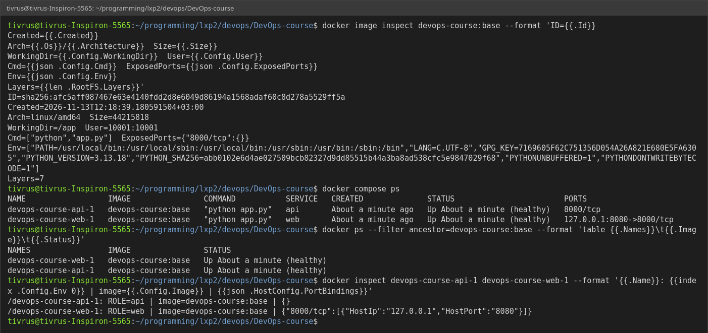
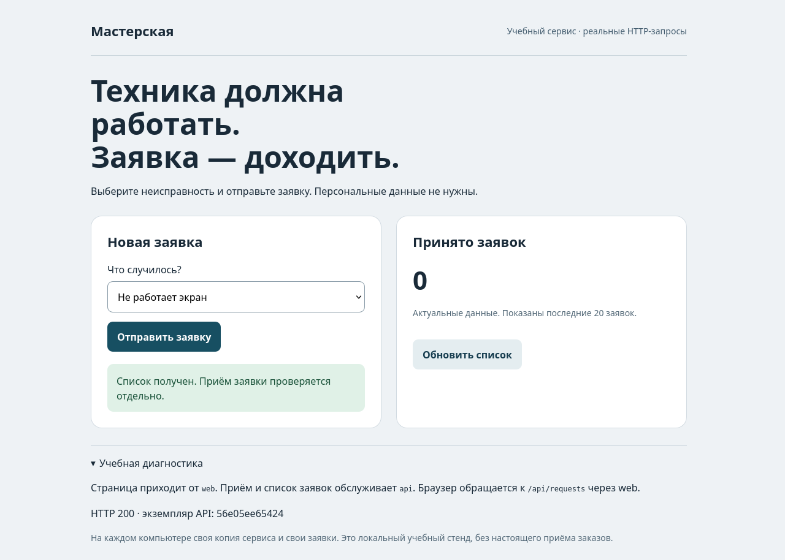
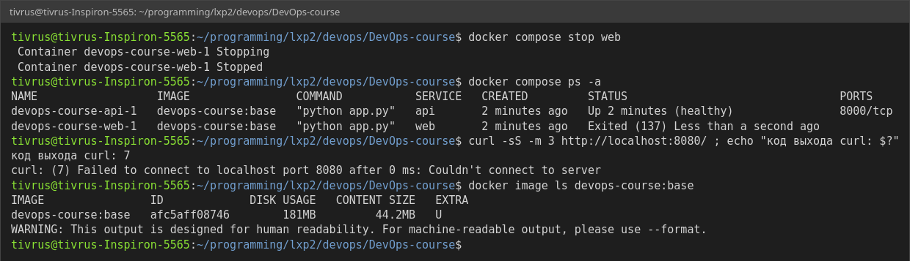
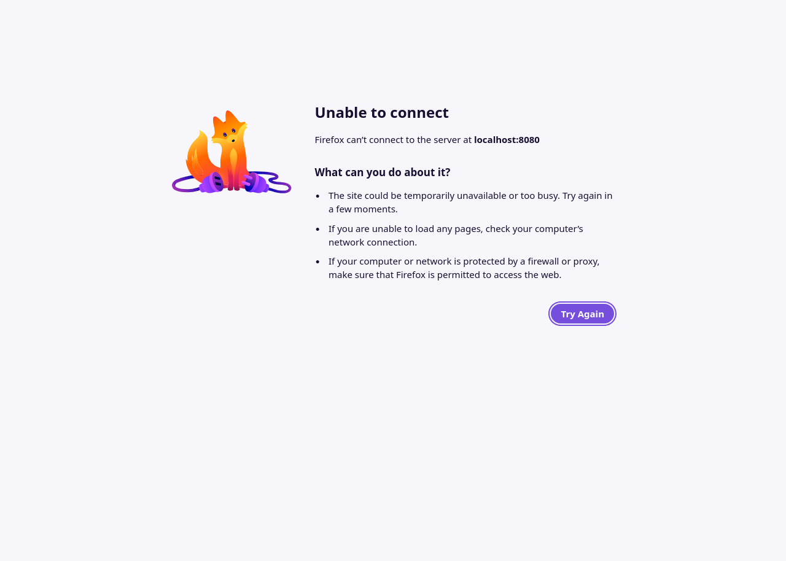
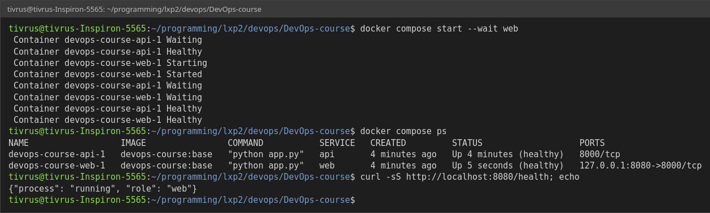
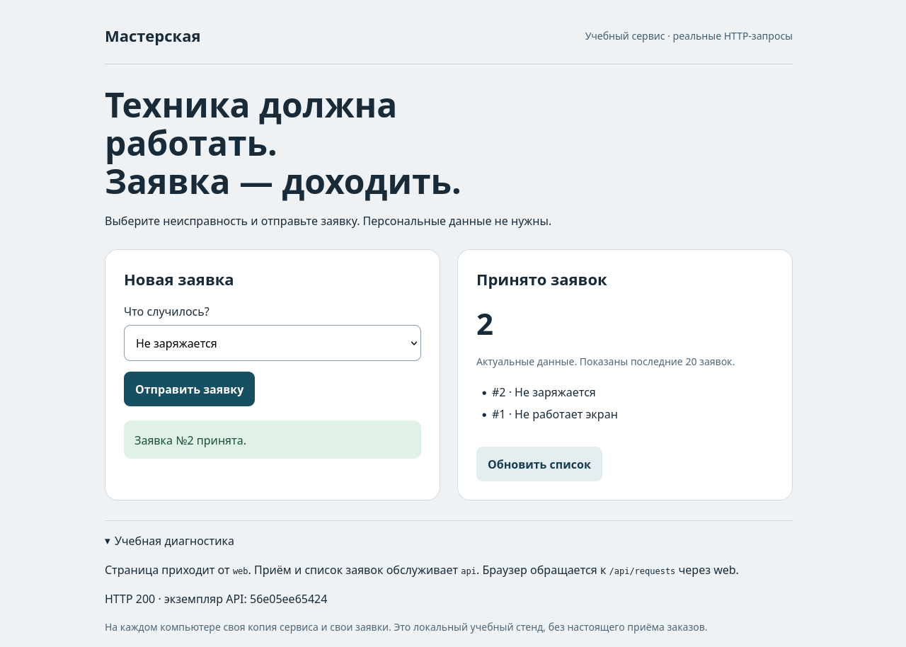
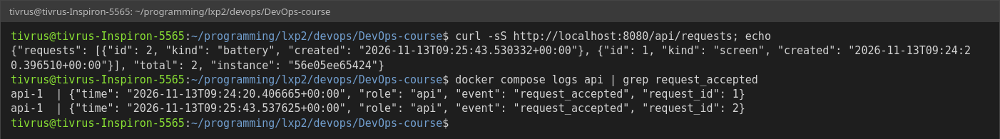

# Работа K2-01. Образ и контейнер

- Группа:
- Код студента (без ФИО): STUDENT-CODE
- Что сделано: изучил образ `devops-course:base` и два контейнера стенда, остановил и снова запустил только `web`, после запуска отправил заявку через страницу.

Стенд подготовлен по `teacher/PREFLIGHT.md` (образ собран командой `docker build -f docker/bootstrap.Dockerfile -t devops-course:base lab`) и запущен `docker compose up -d`. Папка проекта называется `DevOps-course`, поэтому имя Compose-проекта `devops-course`.

## 1. Образ

```text
docker image inspect devops-course:base
```

Полный вывод — [скриншот](screenshots/K2-01-1-image-inspect.png). Важные свойства (то же, через `--format`):

| Свойство | Значение | Что значит |
|---|---|---|
| Id | `sha256:afc5aff08746…` | идентификатор образа по содержимому |
| Os/Architecture | `linux/amd64` | под какую платформу собран |
| Size | 44 215 818 байт (~44 МБ сжатого содержимого) | |
| Слоёв (RootFS.Layers) | 7 | база python:3.13-slim + слои COPY и RUN |
| WorkingDir | `/app` | где лежит приложение |
| User | `10001:10001` | приложение работает не от root |
| Cmd | `["python","app.py"]` | что запускается в контейнере |
| ExposedPorts | `8000/tcp` | порт, который слушает приложение внутри |
| Env | `PYTHONUNBUFFERED=1`, `PYTHONDONTWRITEBYTECODE=1`, `PYTHON_VERSION=3.13.18` | |

В образе нет переменной `ROLE`: роль задаётся при создании контейнера.



## 2. Два контейнера из одного образа

```text
docker compose ps
docker ps --filter ancestor=devops-course:base
```

```text
NAME                  IMAGE                SERVICE   STATUS                   PORTS
devops-course-api-1   devops-course:base   api       Up (healthy)             8000/tcp
devops-course-web-1   devops-course:base   web       Up (healthy)             127.0.0.1:8080->8000/tcp
```

| Контейнер | Роль | Чем отличается |
|---|---|---|
| `devops-course-api-1` | `ROLE=api` — принимает и хранит заявки в SQLite в `/data` (том `requests`) | порт наружу не опубликован, к нему ходит только web по сети Compose |
| `devops-course-web-1` | `ROLE=web` — отдаёт страницу и проксирует `/api/requests` на `API_URL=http://api:8000` | опубликован на `127.0.0.1:8080` |

Код один и тот же (`app.py` из одного образа), а поведение задают переменные окружения из `compose.yaml`.



## 3. Остановка web

```text
docker compose stop web
docker compose ps -a
curl -sS -m 3 http://localhost:8080/
```

- `web` — `Exited (137)`, `api` продолжает работать (`Up (healthy)`).
- curl: `Failed to connect to localhost port 8080 … Couldn't connect to server`, код 7.
- Браузер: «Unable to connect … Firefox can't connect to the server at localhost:8080».
- `docker image ls devops-course:base` — образ на месте.




## 4. Запуск web и отправка заявки

```text
docker compose start --wait web
docker compose ps
curl -sS http://localhost:8080/health
```

Сначала я выполнил `docker compose start web` и сразу curl — получил `curl: (52) Empty reply from server`: контейнер уже `Started`, но приложение внутри ещё не начало отвечать (статус `health: starting`). Поэтому повторил с `--wait`: Compose дождался `healthy`, и `/health` ответил `{"process": "running", "role": "web"}`.

Через страницу http://localhost:8080 отправлены заявки: №1 (после первого запуска) и №2 (после повторного, на скриншоте). Страница показала «Заявка №2 принята.», в списке #2 и #1. В логах api — `request_accepted` с `request_id` 1 и 2.





- Ожидал: при остановленном web страница недоступна, после запуска всё работает, как раньше.
- Получил: так и есть. После `start` заявки принимаются, а старые остались.
- Почему это подтверждает результат: `stop` останавливает процесс контейнера, но не удаляет ни контейнер, ни образ, ни том. `start` запускает тот же контейнер (тот же CREATED в `ps`). Пользователь теряет доступ, потому что только web опубликован на порту 8080 — api при этом жив, но браузер к нему напрямую не ходит. Заявки хранятся в api (том `requests`), поэтому остановка web их не затрагивает.
- Ошибка и её исправление: `Empty reply from server` сразу после `start` — гонка с запуском приложения, решается ожиданием healthcheck (`--wait`).

## Ответ на вопрос

**Удаляется ли образ, когда вы останавливаете web?** Нет. `docker compose stop web` останавливает только процесс в контейнере. Контейнер остаётся (`Exited`), образ `devops-course:base` остаётся в `docker image ls` — из него по-прежнему работает api. Образ — шаблон только для чтения, его удаляет только `docker image rm` (и то, пока на него не ссылается ни один контейнер).

- Использованные источники и помощь: `docs/START.md`, `theory/KT2.md`, документация `docker compose stop/start`; работа выполнялась с помощью ИИ-ассистента Claude (Anthropic), команды выполнены на моём стенде.
