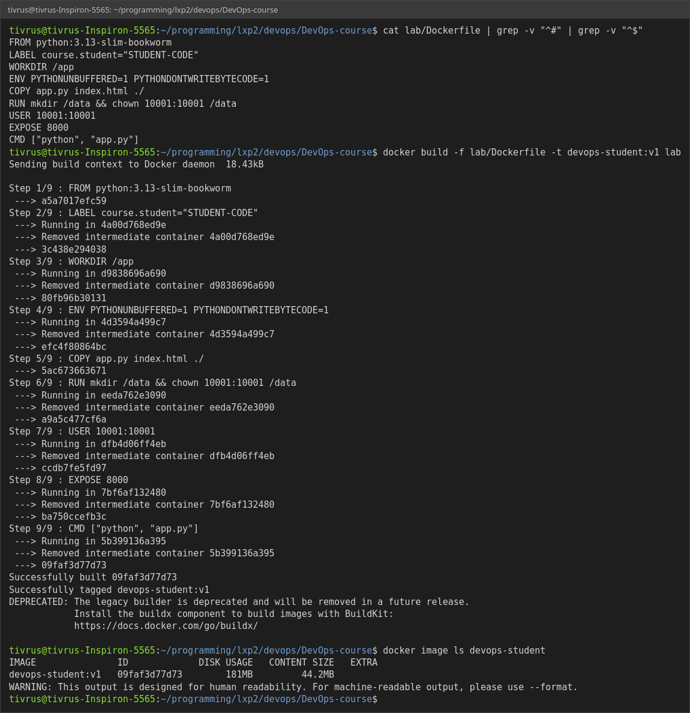
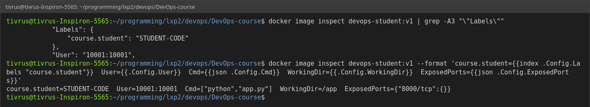
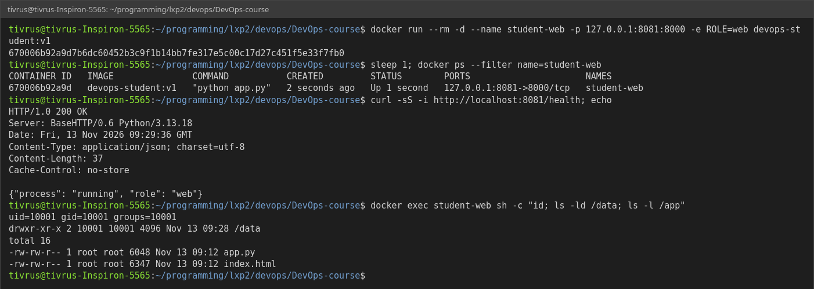
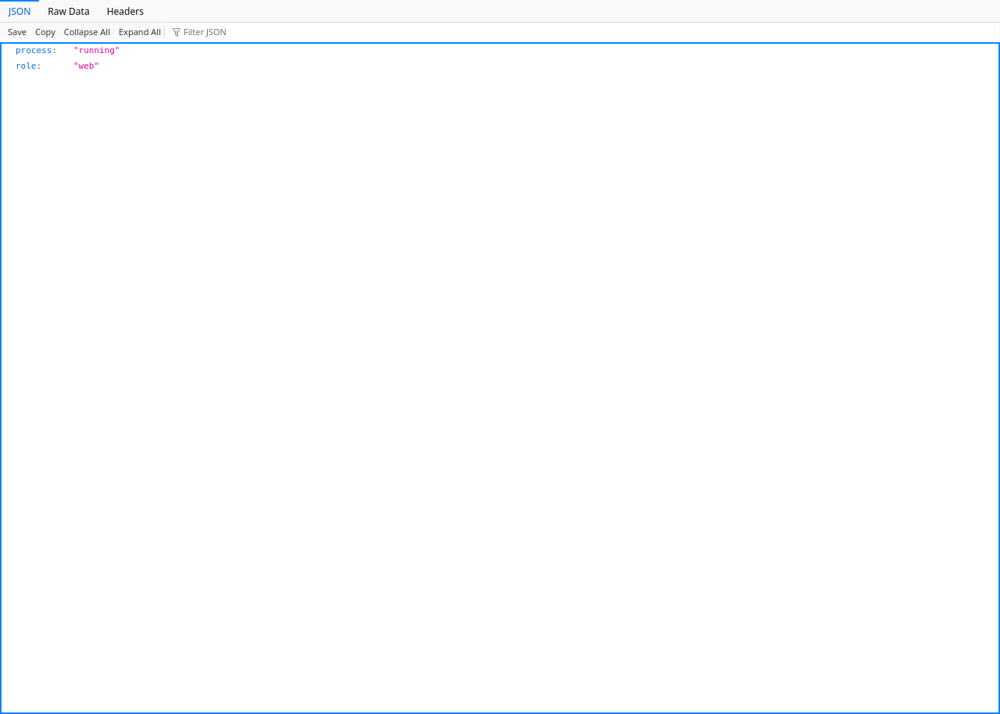
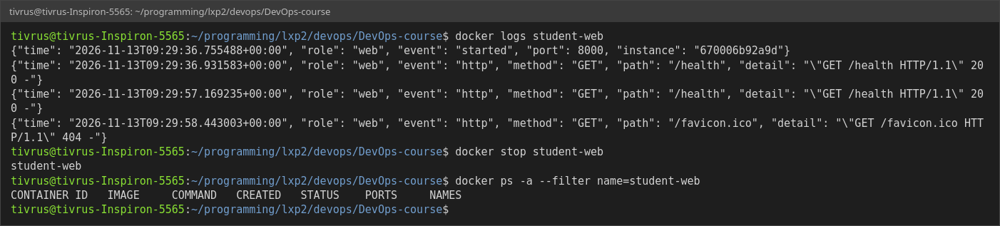

# Работа K2-02. Свой Dockerfile

- Группа:
- Код студента (без ФИО): STUDENT-CODE
- Что сделано: написан [lab/Dockerfile](../lab/Dockerfile) по `templates/Dockerfile.example` и `docker/bootstrap.Dockerfile`, собран образ `devops-student:v1`, проверена метка, запущен контейнер `student-web`, получен ответ `/health`, просмотрены логи, контейнер остановлен.

## Dockerfile

```dockerfile
FROM python:3.13-slim-bookworm
LABEL course.student="STUDENT-CODE"
WORKDIR /app
ENV PYTHONUNBUFFERED=1 PYTHONDONTWRITEBYTECODE=1
COPY app.py index.html ./
RUN mkdir /data && chown 10001:10001 /data
USER 10001:10001
EXPOSE 8000
CMD ["python", "app.py"]
```

| Инструкция | Назначение |
|---|---|
| `FROM` | базовый образ: Python 3.13 на Debian bookworm (slim — без лишних пакетов). Та же база, что у bootstrap |
| `LABEL course.student` | информационная метка автора, попадает в `Config.Labels` образа и не влияет на работу |
| `WORKDIR /app` | рабочая папка; относительные пути в `COPY` и `CMD` считаются от неё |
| `ENV` | `PYTHONUNBUFFERED=1` — вывод `print` сразу уходит в `docker logs`; `PYTHONDONTWRITEBYTECODE=1` — не создавать `.pyc` |
| `COPY app.py index.html ./` | копирует из контекста сборки (`lab`) только два нужных файла; остальное (`.sqlite`, `.env`, кэш) отсекает ещё и `lab/.dockerignore` |
| `RUN mkdir /data && chown 10001:10001 /data` | создаёт папку для базы заявок и отдаёт её пользователю 10001. Без `chown` папку создал бы root, и api под пользователем 10001 получил бы `Permission denied` при записи SQLite |
| `USER 10001:10001` | процесс в контейнере работает не от root. Если в приложении найдут уязвимость, у атакующего будут права обычного пользователя |
| `EXPOSE 8000` | документирует порт, который слушает приложение. Сам по себе ничего не открывает |
| `CMD ["python", "app.py"]` | команда, которая выполняется при запуске контейнера (exec-форма: python — процесс PID 1 и получает сигналы `docker stop`) |

Порядок: редко меняющиеся инструкции выше, `COPY` кода ниже — при изменении `app.py` пересобираются только последние слои.

## Сборка

```text
docker build -f lab/Dockerfile -t devops-student:v1 lab
```

Выполнены 9 шагов, `Successfully built 09faf3d77d73`, `Successfully tagged devops-student:v1`. Сообщение `DEPRECATED: The legacy builder…` — предупреждение о том, что на этом компьютере нет buildx; на результат сборки оно не влияет.



## Метка

```text
docker image inspect devops-student:v1 | grep -A3 '"Labels"'
```

```text
            "Labels": {
                "course.student": "STUDENT-CODE"
            },
            "User": "10001:10001",
```



## Запуск и /health

```text
docker run --rm -d --name student-web -p 127.0.0.1:8081:8000 -e ROLE=web devops-student:v1
curl -i http://localhost:8081/health
docker exec student-web sh -c "id; ls -ld /data"
```

- `docker ps`: `student-web Up … 127.0.0.1:8081->8000/tcp`.
- `/health`: `HTTP/1.0 200 OK`, тело `{"process": "running", "role": "web"}` — в браузере то же самое.
- Внутри контейнера: `uid=10001 gid=10001`, `/data` принадлежит `10001 10001` — USER и права работают.




## Логи и остановка

```text
docker logs student-web
docker stop student-web
```

В логах JSON-события: `started` (port 8000), запросы `GET /health` с кодом 200 и `GET /favicon.ico` 404 (браузер сам запросил иконку). После `docker stop` контейнер исчез и из `docker ps -a` — сработал `--rm`.



- Ожидал: образ соберётся, метка видна в inspect, `/health` отвечает 200.
- Получил: всё так. API в этом запуске нет, поэтому заявки здесь не проверялись — `/health` подтверждает только то, что веб-часть запущена и отвечает.
- Почему это подтверждает результат: метка прочитана из метаданных собранного образа, ответ `/health` получен через опубликованный порт 8081, а `id` внутри контейнера показывает, что процесс работает от 10001.

## Ответ на вопрос

**Почему EXPOSE недостаточно и зачем `-p`?** `EXPOSE` — только запись в метаданных образа («приложение слушает 8000»). Контейнер живёт в своей сети Docker, и браузер на хосте до его порта 8000 не достаёт. `-p 127.0.0.1:8081:8000` создаёт правило проброса: подключения на 127.0.0.1:8081 хоста Docker перенаправляет на порт 8000 контейнера. Привязка к 127.0.0.1 означает, что сервис доступен только с этого компьютера, а не из локальной сети.

- Использованные источники и помощь: `templates/Dockerfile.example`, `docker/bootstrap.Dockerfile`, справочник Dockerfile (docs.docker.com/reference/dockerfile); ИИ-ассистент Claude (Anthropic).
