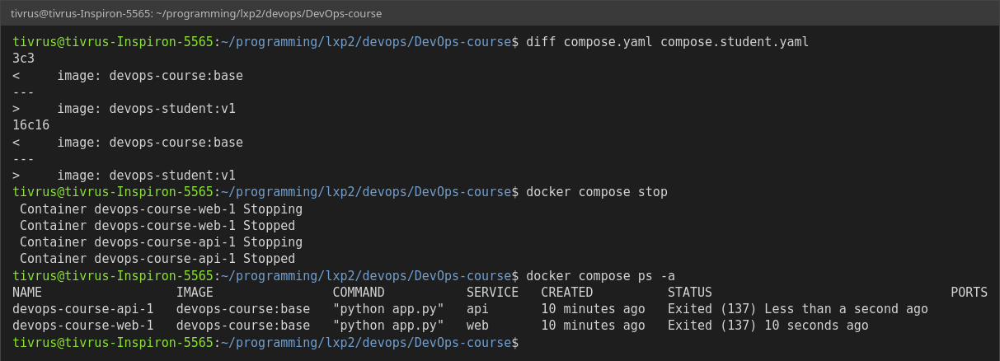
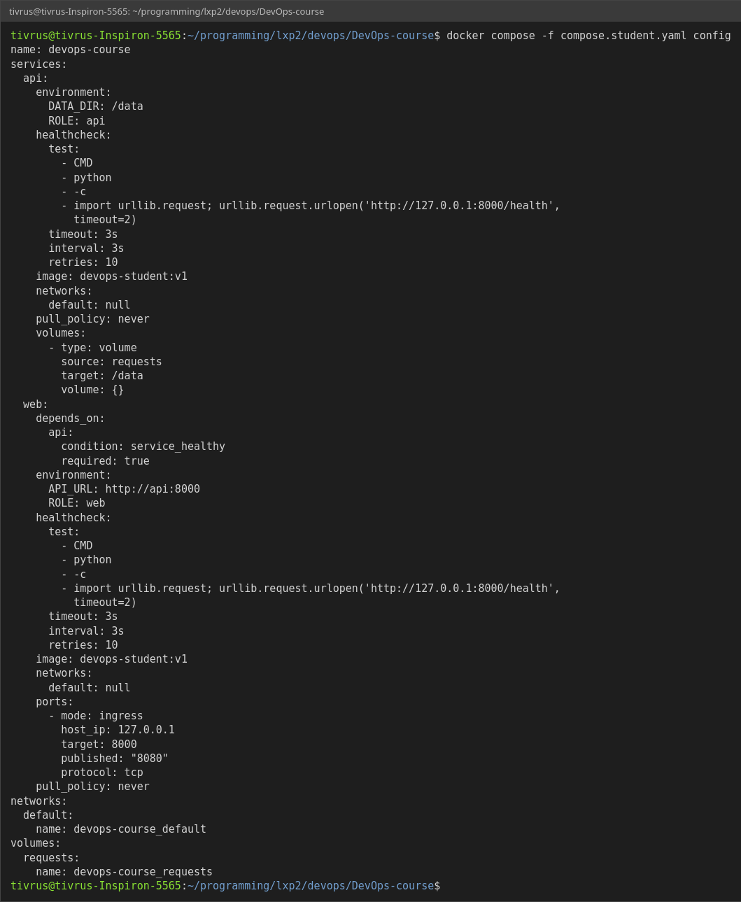
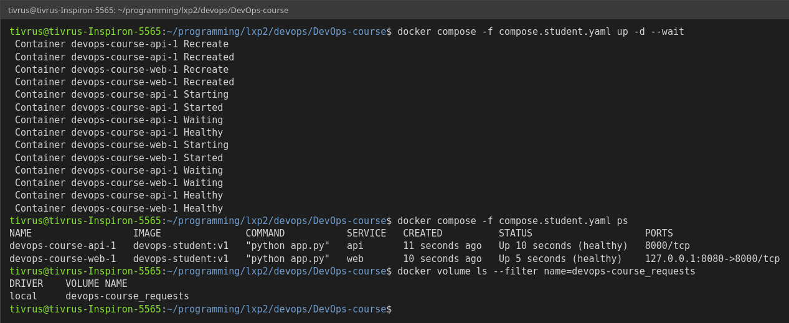
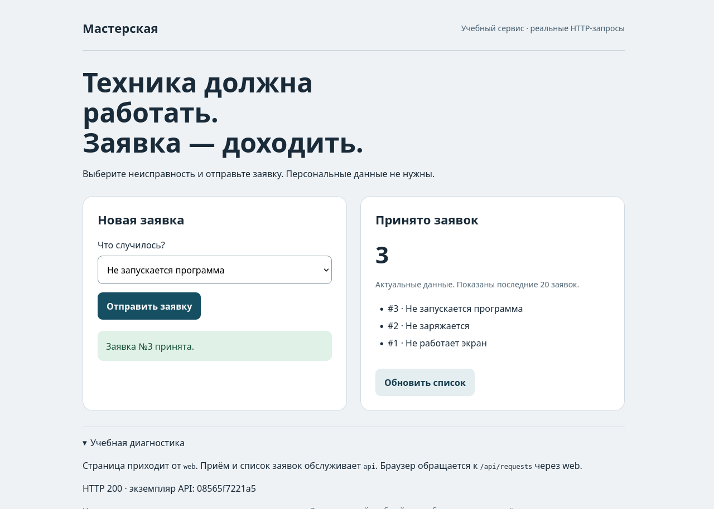
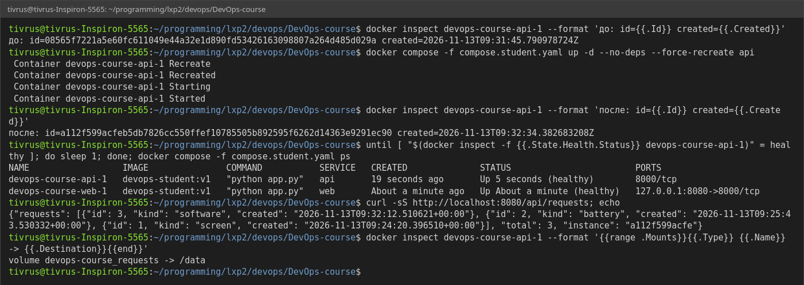
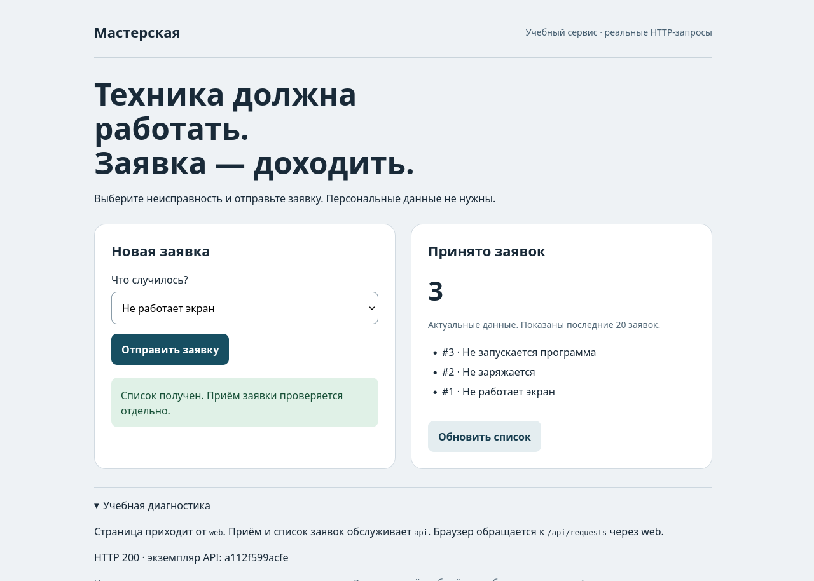
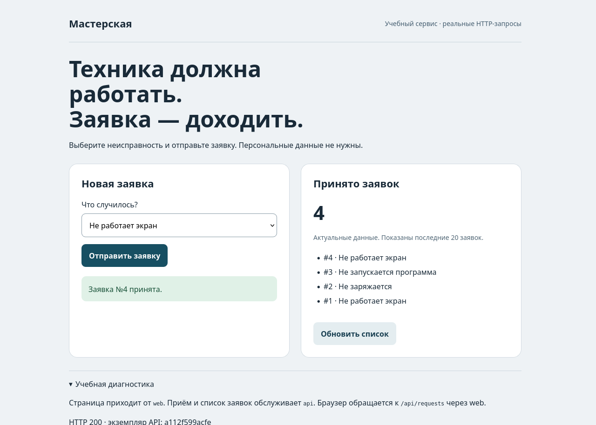
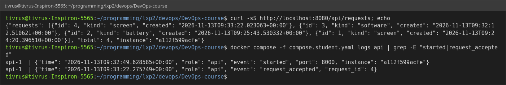

# Работа K2-03. Compose и сохранность данных

- Группа:
- Код студента (без ФИО): STUDENT-CODE
- Что сделано: создан [compose.student.yaml](../compose.student.yaml) — копия `compose.yaml`, где у `api` и `web` образ заменён на `devops-student:v1`. Исходный стенд остановлен, приложение запущено на своём образе, создана заявка, контейнер api пересоздан, старая заявка на месте, создана ещё одна.

## Изменения

```diff
   api:
-    image: devops-course:base
+    image: devops-student:v1
 ...
   web:
-    image: devops-course:base
+    image: devops-student:v1
```

Остальные сервисы (`tools`, `registry`, `prometheus`, `grafana`, `ansible`) не менялись.

## Команды и результат

```text
docker compose stop
docker compose -f compose.student.yaml config
docker compose -f compose.student.yaml up -d --wait
docker compose -f compose.student.yaml ps
```

`config` прочитал файл без ошибок (`name: devops-course`, сервисы api и web с `image: devops-student:v1`). `up -d` пересоздал оба контейнера (`Recreate`), потому что изменился образ. Флаг `--wait` добавлен, чтобы команда вернулась, когда оба сервиса станут `healthy`.

```text
NAME                  IMAGE               SERVICE   STATUS
devops-course-api-1   devops-student:v1   api       Up (healthy)   8000/tcp
devops-course-web-1   devops-student:v1   web       Up (healthy)   127.0.0.1:8080->8000/tcp
```





**Первая заявка: №3** («Не запускается программа»). Номера 1 и 2 — заявки из K2-01: проект и том те же, `compose.student.yaml` — не отдельный стенд, поэтому список продолжился.



### Пересоздание api

```text
docker compose -f compose.student.yaml up -d --no-deps --force-recreate api
```

| | ID контейнера api |
|---|---|
| до | `08565f7221a5…` |
| после | `a112f599acfe…` |

Контейнер действительно новый (другой ID и время создания; на странице «экземпляр API» сменился с `08565f7221a5` на `a112f599acfe`). После готовности (`healthy`) `GET /api/requests` вернул `total: 3`, заявки №3, №2, №1 на месте. Новый контейнер подключён к тому же тому: `volume devops-course_requests -> /data`.

Затем создана **заявка №4**, `total: 4`, в логах нового api — `request_accepted`, `request_id: 4`.






## Как устроено

**API_URL и связь сервисов.** `web` не хранит заявки сам — он пересылает `/api/requests` на адрес из `API_URL=http://api:8000`. Compose создаёт для проекта сеть `devops-course_default` и регистрирует в её DNS имена сервисов, поэтому внутри сети `api` разрешается в IP контейнера api. Это адрес для связи *между контейнерами*. Из браузера на хосте имя `api` не работает — пользователь заходит только на `localhost:8080`.

```text
браузер → 127.0.0.1:8080 (хост) → web:8000 → http://api:8000 (сеть Compose) → api → /data (том requests)
```

**Порты.**

| Порт | Где | Зачем |
|---|---|---|
| 8000 | внутри контейнеров web и api | приложение слушает его в обеих ролях |
| 8080 | хост, `127.0.0.1:8080:8000` у web | единственная точка входа для браузера; привязка к 127.0.0.1 — только с этого компьютера |
| — | api | порт наружу не опубликован, api доступен только web внутри сети |
| 5000 | хост, у registry (профиль `registry`) | понадобится в K2-04 |

**Том.** `requests:/data` у api — именованный том `devops-course_requests`. Файл базы `/data/requests.sqlite` хранится в нём, а не в слое контейнера. Контейнер можно удалить или пересоздать — том отдельный объект Docker и подключается к новому контейнеру. Поэтому заявка №3 пережила `--force-recreate`.

## Инструкция запуска

Из корня репозитория:

```text
docker build -f lab/Dockerfile -t devops-student:v1 lab        # один раз или после изменения lab/
docker compose stop                                             # если запущен исходный стенд
docker compose -f compose.student.yaml up -d --wait             # запуск api и web на своём образе
docker compose -f compose.student.yaml ps                       # оба healthy
```

Открыть http://localhost:8080, отправить заявку. Остановка без потери данных: `docker compose -f compose.student.yaml stop`. Не использовать `down -v` — удалит том с заявками.

- Ожидал: после пересоздания api заявка №3 останется, новая получит следующий номер.
- Получил: №3 на месте, новая — №4.
- Почему это подтверждает результат: ID контейнера сменился, значит его файловая система новая; данные пришли только из тома.

## Ответ на вопрос

**Почему базу нельзя хранить только внутри контейнера?** Без тома файл SQLite лежал бы в записываемом слое конкретного контейнера. `--force-recreate`, обновление образа или `docker compose down` удаляют контейнер вместе с этим слоем — новый контейнер стартует из чистого образа с пустой базой, все заявки пропадают. С томом жизненный цикл данных отделён от жизненного цикла контейнера.

- Использованные источники и помощь: `docs/START.md`, справочник Compose (docs.docker.com/reference/compose-file/services); ИИ-ассистент Claude (Anthropic).
