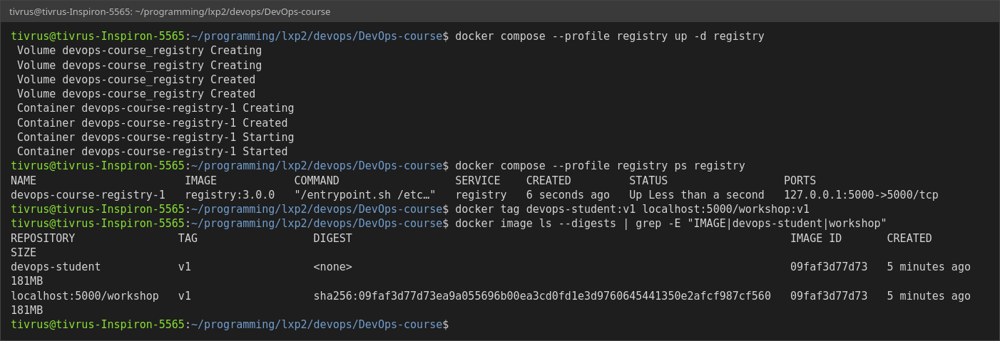
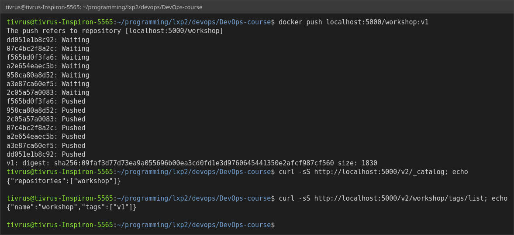
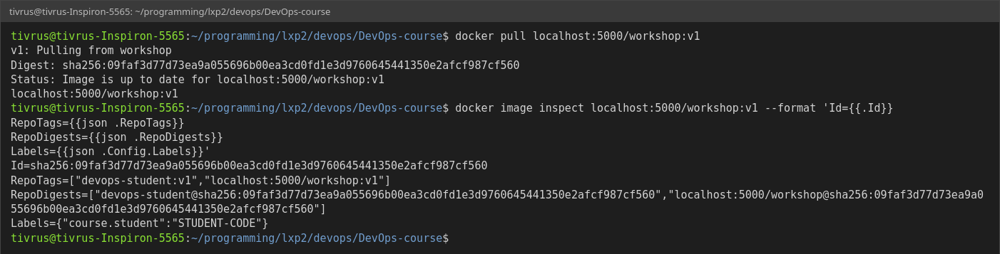
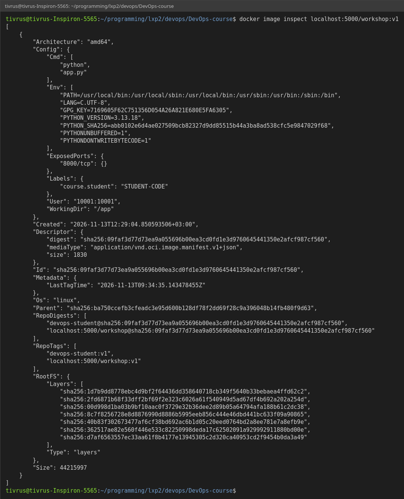

# Работа K2-04. Registry

- Группа:
- Код студента (без ФИО): STUDENT-CODE
- Что сделано: запущен локальный registry, образу `devops-student:v1` добавлен тег `localhost:5000/workshop:v1`, образ отправлен (push) и получен обратно (pull), сохранён digest. Файлы проекта не менялись.

## Команды и результат

```text
docker compose --profile registry up -d registry
docker tag devops-student:v1 localhost:5000/workshop:v1
docker push localhost:5000/workshop:v1
docker pull localhost:5000/workshop:v1
docker image inspect localhost:5000/workshop:v1
```

**Registry.** Создан том `devops-course_registry`, контейнер `devops-course-registry-1` (`registry:3.0.0`), порт `127.0.0.1:5000->5000/tcp`.

**Tag.** После `docker tag` у одного и того же образа два имени — `devops-student:v1` и `localhost:5000/workshop:v1`, IMAGE ID одинаковый (`09faf3d77d73`). Копия не создаётся.



**Push.** Отправлены 7 слоёв (все `Pushed`), итог:

```text
v1: digest: sha256:09faf3d77d73ea9a055696b00ea3cd0fd1e3d9760645441350e2afcf987cf560 size: 1830
```

Проверка через HTTP API registry: `/v2/_catalog` → `{"repositories":["workshop"]}`, `/v2/workshop/tags/list` → `{"name":"workshop","tags":["v1"]}`.



**Pull.**

```text
v1: Pulling from workshop
Digest: sha256:09faf3d77d73ea9a055696b00ea3cd0fd1e3d9760645441350e2afcf987cf560
Status: Image is up to date for localhost:5000/workshop:v1
```

Слои не скачивались заново: все они уже есть локально, Docker сравнил digest манифеста в registry с локальным — совпал. Это не ошибка.

`docker image inspect localhost:5000/workshop:v1`: `RepoTags` — оба имени, `RepoDigests` — `localhost:5000/workshop@sha256:09faf3d7…cf560`, `Labels` — `{"course.student":"STUDENT-CODE"}`, т.е. это тот самый образ из K2-02.




**Сохранённый digest:**

```text
localhost:5000/workshop@sha256:09faf3d77d73ea9a055696b00ea3cd0fd1e3d9760645441350e2afcf987cf560
```

(На этом Docker 29 используется containerd image store, поэтому Image ID совпадает с digest манифеста.)

## Tag и digest

| | Tag (`v1`) | Digest (`sha256:09fa…`) |
|---|---|---|
| Что это | имя-указатель, выбранное человеком | хэш содержимого манифеста образа |
| Можно ли изменить | да: после новой сборки и push тот же `v1` будет указывать на другой образ | нет: другое содержимое — другой digest |
| Для чего | удобно читать и обновлять (`v1`, `latest`) | точно зафиксировать версию: `docker pull localhost:5000/workshop@sha256:09fa…` всегда даст именно этот образ или ошибку |

Поэтому для отчёта и воспроизводимого запуска сохраняется digest: по тегу через месяц может приехать уже другой образ.

- Ожидал: push и pull пройдут, digest в обоих выводах совпадёт.
- Получил: совпал, `sha256:09faf3d7…cf560`.
- Почему это подтверждает результат: registry вернул тот же digest, что получен при push, значит в хранилище лежит ровно отправленный образ.

## Ответ на вопрос

**Почему после push приложение не запускается автоматически?** Registry — только хранилище образов, как склад. `push` кладёт туда файлы образа и больше ничего не делает: он не знает, где и с какими настройками (порты, переменные, тома) его запускать. Запуск — отдельный шаг deployment: кто-то (человек, `docker compose up`, CD-пайплайн, Kubernetes) должен сделать `pull` и создать контейнер.

- Использованные источники и помощь: docs.docker.com (docker image push/pull, image digests), Distribution registry API; ИИ-ассистент Claude (Anthropic).
