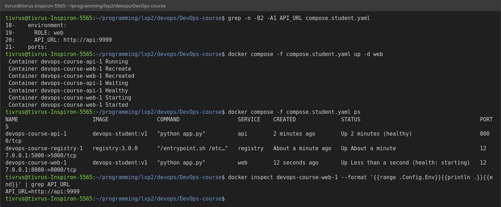
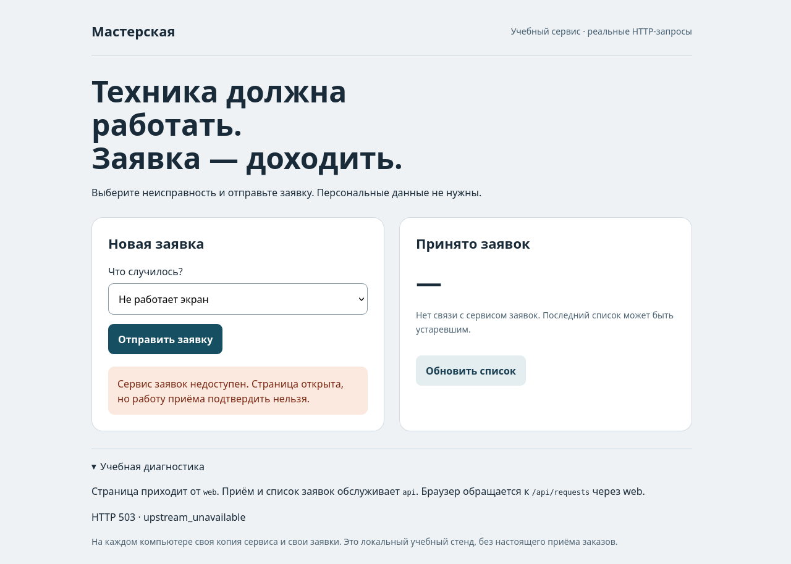
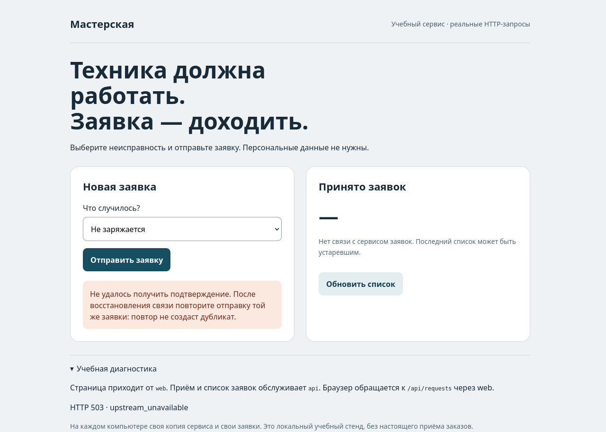
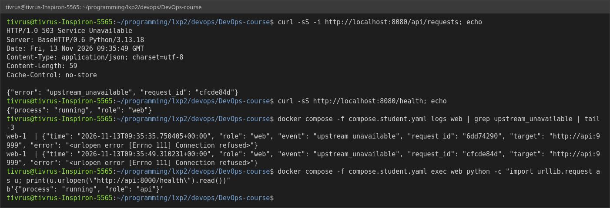
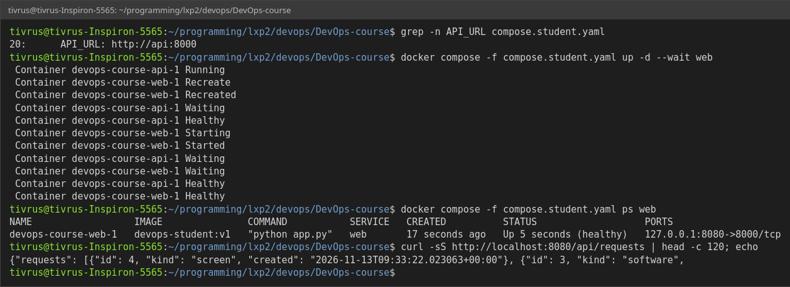
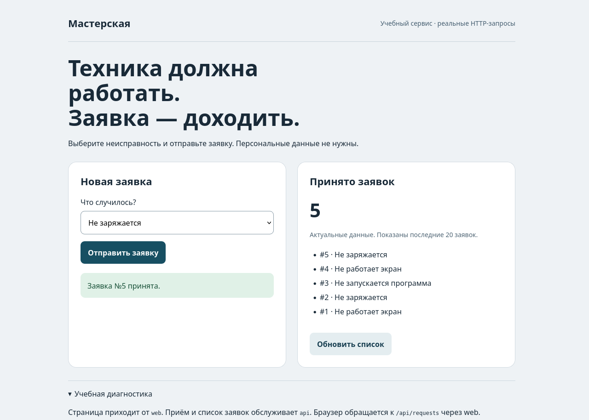
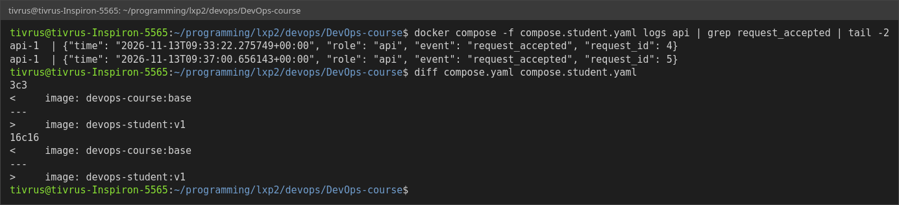

# Работа K2-05. Ошибка конфигурации

- Группа:
- Код студента (без ФИО): STUDENT-CODE
- Что сделано: в `compose.student.yaml` у web временно задан `API_URL: http://api:9999`, изменение применено, ошибка найдена на странице и в логах, порт возвращён на 8000, после этого заявка успешно отправлена. Итоговый [compose.student.yaml](../compose.student.yaml) снова содержит `http://api:8000`.

## Ошибка

```text
# compose.student.yaml, сервис web
API_URL: http://api:9999
docker compose -f compose.student.yaml up -d web
```

Compose пересоздал только web (`Recreate`), api остался `Running`. В новом контейнере `API_URL=http://api:9999`. Статус web — `Up (healthy)`: контейнер работает.



**Что видит пользователь.** Страница открывается, но: «Сервис заявок недоступен. Страница открыта, но работу приёма подтвердить нельзя.», счётчик «—», диагностика `HTTP 503 · upstream_unavailable`. Попытка отправить заявку — «Не удалось получить подтверждение…».




**Что в ответах и логах.**

```text
$ curl -i http://localhost:8080/api/requests
HTTP/1.0 503 Service Unavailable
{"error": "upstream_unavailable", "request_id": "cfcde84d"}

$ curl http://localhost:8080/health
{"process": "running", "role": "web"}

$ docker compose -f compose.student.yaml logs web | grep upstream_unavailable
web-1  | {"time": "2026-11-13T09:35:49.310231+00:00", "role": "web", "event": "upstream_unavailable",
         "request_id": "cfcde84d", "target": "http://api:9999",
         "error": "<urlopen error [Errno 111] Connection refused>"}
```

`request_id` в ответе пользователю и в логе совпадает (`cfcde84d`) — по нему ответ из браузера связывается со строкой лога.

Контрольная проверка изнутри web: `http://api:8000/health` отвечает `{"process": "running", "role": "api"}`. Значит, api жив и имя `api` разрешается — неверен только порт.



## Причина

Имя `api` в сети Compose разрешилось в IP контейнера api, TCP-пакет дошёл до него, но на порту 9999 внутри контейнера никто не слушает — приложение api слушает 8000. Ядро контейнера отвечает отказом в соединении: `[Errno 111] Connection refused`. web ловит эту ошибку и отдаёт браузеру 503 `upstream_unavailable`.

Healthcheck web проверяет только собственный `/health` web, поэтому контейнер остаётся `healthy` — проверка не знает о зависимости от api. Отсюда вывод: «контейнер запущен» не равно «приложение выполняет задачу», нужно смотреть на пользовательский сценарий и логи.

## Исправление

```text
# compose.student.yaml, сервис web
API_URL: http://api:8000
docker compose -f compose.student.yaml up -d --wait web
```

web пересоздан и `healthy`, `GET /api/requests` снова возвращает список. Через страницу отправлена **заявка №5** — «Заявка №5 принята.», в списке №1–№5 (старые заявки на месте), в логах api — `request_accepted`, `request_id: 5`. `diff compose.yaml compose.student.yaml` показывает только замену образа — ошибочный порт не остался.





- Ожидал: при 9999 список и отправка перестанут работать, web останется запущен.
- Получил: так и есть — 503 `upstream_unavailable`, `Connection refused` в логах, после возврата 8000 заявка №5 принята.
- Почему это подтверждает результат: менялся только порт в `API_URL`, и ошибка появилась/исчезла вместе с ним.

## Ответ на вопрос

**8080 или 8000?** 8000. Внутри сети Compose web обращается к контейнеру api напрямую, а api слушает порт 8000 (`PORT` по умолчанию в `app.py`, `EXPOSE 8000`). 8080 — это порт на хосте, опубликованный у web (`127.0.0.1:8080:8000`). Он существует только на хосте и ведёт в web, а не в api; у api вообще нет опубликованных портов. Публикация порта (`ports`) нужна для доступа снаружи, а между контейнерами используются внутренние порты.

- Использованные источники и помощь: `lab/app.py` (функция `proxy`), `docs/TROUBLESHOOTING.md`; ИИ-ассистент Claude (Anthropic).
