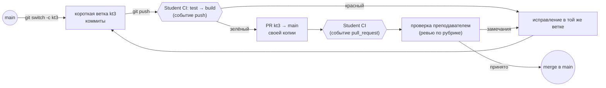

# Работа K3-01. CI/CD и ветки

- Группа:
- Код студента (без ФИО): STUDENT-CODE
- Что сделано: описан маршрут изменений для учебного сервиса «Мастерская» в моей копии `Tivrus/DevOps-course`: событие запуска, тест, сборка, решение о выпуске; нарисована схема веток; маршрут сравнён с Git-flow.

## Что происходит с изменением

| Шаг | В моём проекте | Кто/что делает |
|---|---|---|
| **Событие** | `push` в любую ветку и `pull_request` в `main` — workflow `Student CI` (`.github/workflows/student-ci.yml`, `on: push, pull_request`) | GitHub автоматически |
| **Автоматический тест** | job `test`: checkout → setup-python 3.13 → `python -m unittest discover -s tests -p test_app.py -v`. Тесты поднимают api и web из `lab/app.py` и проверяют HTTP-контракт: `POST /api/requests` → 201, повтор без дубликата, 400 на мусор, 503 при падении api, метрики | GitHub Actions runner `ubuntu-latest` |
| **Сборка** | job `build` (`needs: test`): `docker build -f lab/Dockerfile -t devops-student:${{ github.sha }} lab`. Запускается только если тесты прошли | GitHub Actions |
| **Решение о выпуске** | отдельное и ручное: преподаватель проверяет PR, после приёмки я сливаю его в `main`. Образ из CI никуда не публикуется и не запускается | человек |

### CI, continuous delivery, continuous deployment

- **Continuous Integration** — каждое изменение автоматически собирается и тестируется сразу после push. Цель — быстро узнать, что изменение что-то сломало. Это то, что делает `Student CI`.
- **Continuous Delivery** — дополнительно каждое прошедшее проверки изменение превращается в готовый к выпуску артефакт (например, образ в registry), но **выпуск в работу запускает человек** одной кнопкой/командой.
- **Continuous Deployment** — прошедшее проверки изменение **автоматически, без человека** выкатывается в рабочее окружение.

В моём проекте есть только CI: образ собирается на runner для проверки, что Dockerfile рабочий, и пропадает вместе с runner. Ни delivery (публикации в registry), ни deployment (запуска где-либо) нет — решение о выпуске принимает человек при слиянии PR.

## Схема веток

Текстом: `main` → ветка `kt3` → `push` (CI на push) → PR `kt3 → main` моей копии (CI на pull_request) → проверка преподавателем → merge. Проверки стоят на каждом `push` в ветку и на PR — до слияния, поэтому сломанный код не попадает в `main`.

**Где появится обратная связь об ошибке:** через несколько минут после `git push` — на вкладке Actions и в PR красным статусом у коммита, в шаге, который упал (например, `FAIL: test_create_request … AssertionError`). Это происходит до ревью и до слияния, когда изменение ещё маленькое и свежее в голове.

## Сравнение с Git-flow

| | Моя схема (GitHub flow / trunk-based) | Git-flow |
|---|---|---|
| Долгоживущие ветки | только `main` | `main` + `develop` |
| Короткие ветки | `kt2`, `kt3`… от `main`, PR сразу в `main` | `feature/*` от `develop`, `release/*`, `hotfix/*` |
| Выпуск | слияние в `main` после проверки | отдельная ветка `release/*`, стабилизация, слияние в `main` и обратно в `develop`, тег версии |
| Когда подходит | один разработчик, частые маленькие изменения, нет нескольких поддерживаемых версий | большая команда, плановые релизы, несколько версий в поддержке одновременно |

**Почему простая схема:** работу делает один человек, каждая КТ — небольшой самостоятельный набор изменений, нет параллельно поддерживаемых версий и релизного цикла. В Git-flow пришлось бы держать `develop`, делать два слияния вместо одного и синхронизировать ветки — накладные расходы без пользы. Одна короткая ветка на КТ и PR в `main` дают всё нужное: изолированную работу, автоматическую проверку до слияния и одну понятную точку для проверки преподавателем.

## Ответ на вопрос

**Является ли сборка образа автоматическим deployment?** Нет. Сборка создаёт артефакт (образ) — это часть CI. Deployment — это запуск новой версии там, где ею пользуются: контейнер должен быть создан из образа и начать обслуживать запросы. В `Student CI` образ собирается на временном runner, никуда не отправляется и нигде не запускается, после завершения job runner уничтожается вместе с образом.

- Использованные источники и помощь: `theory/KT3.md`, docs.github.com (About continuous integration, GitHub flow), статья Vincent Driessen «A successful Git branching model»; ИИ-ассистент Claude (Anthropic).
